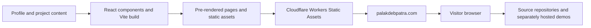

# Portfolio implementation and deployment plan

Version 0.1 · Recommended architecture · 7 October 2026

## 1. Architecture decisions

| Layer | Proposed choice | Reason |
| --- | --- | --- |
| UI | React + TypeScript | Requested React stack with typed reusable components |
| Build/development | Vite | Requested build tooling and fast local development |
| Routing/rendering | React Router framework mode with its Vite plugin; build-time pre-rendering | Direct project URLs with meaningful initial HTML and route metadata |
| Styling | CSS Modules plus global design tokens | A compact custom design system with few dependencies |
| Icons | Small, selectively imported SVG icon set | Consistent controls without a large asset payload |
| Content | Typed local project/profile data and structured case-study sections | Easy updates and predictable rendering without a backend |
| Hosting | Cloudflare Workers Static Assets | Static delivery and custom-domain integration |
| Quality | Type checking, linting, targeted Playwright checks, manual accessibility review | Verify build integrity and real visitor journeys |

React Router is an additional routing/build layer on the requested React + Vite stack. Set `ssr: false` and explicitly enumerate `/`, `/projects`, and every published project slug for pre-rendering. This produces HTML at build time without an application server in production. See [React Router pre-rendering](https://reactrouter.com/how-to/pre-rendering).

Use the current stable compatible package releases at implementation time, then commit the lockfile and pin the Node version used by local and hosted builds. Do not select versions from an outdated template guide. The workspace currently has Node `v24.19.0` and npm `11.17.0`; on this Windows setup, use `npm.cmd` because PowerShell blocks the `npm.ps1` shim. Node compatibility must be checked against the chosen releases. See [Vite's setup requirements](https://vite.dev/guide/).

## 2. Data and runtime boundaries



The launch site needs no database, authentication, or API server. Visitors can browse content and follow links; projects are not executed inside the portfolio. No GitHub API request is needed for initial rendering. Do not put provider credentials into browser code or `VITE_*` values.

## 3. Planned repository structure

```text
Portfolio/
  README.md
  docs/
    requirements.md
    design-spec.md
    implementation-plan.md
  app/
    root.tsx
    routes.ts
    routes/
      home.tsx
      projects.tsx
      project-detail.tsx
      not-found.tsx
    components/
      SiteHeader.tsx
      SiteFooter.tsx
      ProjectCard.tsx
      ProjectFilters.tsx
      CaseStudySections.tsx
    content/
      profile.ts
      projects.ts
      case-studies/
    styles/
      tokens.css
      global.css
  public/
    favicon.svg
    images/projects/
    fonts/
    resume/                  # only when supplied
    _headers
  scripts/
    validate-content.mjs
    finalize-static-output.mjs
  tests/
    portfolio.spec.ts
  react-router.config.ts
  vite.config.ts
  wrangler.jsonc
  package.json
  package-lock.json
```

This is a proposed structure, not existing application code. The project will become its own Git repository during implementation, keeping neighboring repositories untouched. Run its commands from `Portfolio/`.

## 4. Content model

Each project record contains:

| Fields | Purpose |
| --- | --- |
| `slug`, `title`, `summary` | Identity, URL, and card copy |
| `categories`, `technologies` | Filtering and technical context |
| `featured`, `order`, `published` | Editorial placement and publication control |
| `status`, `role` | Accurate project state and contribution |
| `cover`, `coverAlt`, `gallery` | Images, dimensions, captions, and alternatives |
| `sourceUrl`, `demoUrl` | Optional verified destinations |
| `caseStudy` | Problem, contribution, approach, decisions, outcomes, limitations |
| `evidence` | References supporting any measured outcomes |

Use structured text/section data for launch. Add Markdown/MDX later if writing volume makes it worthwhile. A private or draft record must not be included in public bundles, generated routes, or sitemap content.

The profile record contains the public name, approved headline and bio, optional resume path, public email, and verified social links. Separate editorial review notes from public records.

Build validation checks unique slugs, required fields on published records, referenced local assets, valid category identifiers, supported URL schemes, and matching case-study records. Optional absent fields should render cleanly. External URL reachability is a release review rather than a network dependency for every build.

## 5. Rendering and static output

Pre-render all published routes from the same content manifest used by the project index. Each route gets its own title, description, canonical address, and visible project content in HTML. Optional browser enhancements handle filtering and clipboard behavior after hydration.

Expected publish directory: `build/client` for the proposed React Router build. Confirm this with the selected releases. A finalization step generates `sitemap.xml`, `robots.txt`, and `404.html`, and validates that every published slug has an HTML document. Keep any build-time server bundle outside the upload directory.

Set Cloudflare asset handling to `not_found_handling: "404-page"` and `html_handling: "drop-trailing-slash"` for the proposed URL convention. Publish a real `404.html` and test that direct requests to unknown routes return HTTP 404. Avoid a catch-all SPA rewrite that would turn unknown project URLs into success responses. See [Cloudflare static generation and 404 routing](https://developers.cloudflare.com/workers/static-assets/routing/static-site-generation/).

Test both direct requests and browser navigation: generated `.data` files, project paths, trailing-slash normalization, and unknown slugs. Canonical URLs and sitemap URLs must use the same convention.

## 6. Delivery milestones

| Milestone | Work | Exit condition |
| --- | --- | --- |
| 1. Foundation and visual slice | Set up React/TypeScript/Vite, routing, tokens, header, hero, and one project card | Recognizable homepage; production build and one pre-rendered detail route work |
| 2. Complete visitor journeys | Featured work, index/filtering, reusable case-study layout, About, Contact, mobile navigation, 404 | Browse home → index → detail → contact on desktop and phone |
| 3. Content and assets | Prepare shortlisted projects, verify claims and links, capture/crop screenshots, add supplied bio/resume | Published content contains accurate facts and no draft placeholders |
| 4. Quality and deployment preparation | Metadata, sitemap, static routing, headers, accessibility/performance review, targeted tests | Build and release checks pass; deployment artifact is reviewable |
| 5. Hosting and domain | Connect repository, deploy preview, connect apex, configure `www` redirect, verify HTTPS | Portfolio works at `palakdebpatra.com` with working direct links |

The current request completes planning only. Later implementation starts with milestone 1. Content work can overlap component development. Publication requires the necessary account access and reviewed public content; the present turn makes no hosting or DNS changes.

## 7. Validation strategy

Run type checking, linting, and a production build from the portfolio repository. Use a small set of browser tests focused on behavior:

- Navigation and direct loading of a project URL.
- Project filtering, reset, query parameters, and browser back/forward.
- Mobile menu operation with keyboard and Escape.
- Email-copy feedback and fallback, with resume omitted when absent.
- Useful unknown-route handling; independently verify HTTP status at the hosting layer.

Inspect initial HTML for the homepage and representative detail pages to verify content, canonical metadata, and titles before JavaScript runs. Inspect the generated sitemap and static output. Manually review keyboard order, contrast, reduced motion, zoom, and small-screen layouts; automated accessibility checks supplement that review.

Measure one mobile Lighthouse run on home and one representative detail page, recording browser/tool version and throttling conditions. Re-run only after changes that materially affect the result or to resolve a failing target.

No tests or dependency installations are needed for these planning documents. Python helpers, if later required, use `C:/Users/palak/anaconda3/envs/starGPU/python.exe`.

## 8. Cloudflare deployment plan

Recommended: deploy the pre-rendered output through Workers Static Assets. Cloudflare supports static files without a custom application Worker script; its [React + Vite guide](https://developers.cloudflare.com/workers/framework-guides/web-apps/react/) also covers the broader frontend/API setup. We only need the static delivery capability at launch. See [Static Assets](https://developers.cloudflare.com/workers/static-assets/).

Deployment configuration will identify the portfolio Worker, compatibility date, `build/client` asset directory, and static routing rules. Use repository-based builds with a committed lockfile. Build command: `npm run build`; deployment command: `npx wrangler deploy`. Configure nonproduction branches for preview/version URLs and `main` for production according to the current Workers Builds controls. See [Workers Builds](https://developers.cloudflare.com/workers/ci-cd/builds/).

Domain sequence:

1. Confirm control of `palakdebpatra.com`, an active Cloudflare zone, account access, and any existing web records.
2. Deploy and review the portfolio at its Cloudflare preview address.
3. Attach `palakdebpatra.com` as the Worker's Custom Domain. Cloudflare handles associated DNS/certificate setup; inspect any conflicting existing web record before replacing it.
4. Set up a proxied DNS record and a permanent redirect for `www.palakdebpatra.com` to the apex, preserving path and query string.
5. Verify certificate activation, HTTP-to-HTTPS behavior, apex responses, redirect behavior, static assets, and direct detail routes.
6. Preserve unrelated MX/TXT records and existing services. Do not assume Cloudflare DNS registration alone means the portfolio is already hosted.

The Custom Domain and `www` redirect requirements are described in [Cloudflare's Custom Domains documentation](https://developers.cloudflare.com/workers/configuration/routing/custom-domains/). Nameserver/account status and existing records remain unverified.

Alternative: Cloudflare Pages can also publish static Vite output with Git integration. For this proposed architecture, use `npm run build` and `build/client`; a plain Vite React build would normally use `dist`. Attaching an apex domain through Pages requires that domain to be a zone in the same Cloudflare account with the appropriate nameservers. See [Pages Vite deployment](https://developers.cloudflare.com/pages/framework-guides/deploy-a-vite3-project/) and [Pages custom domains](https://developers.cloudflare.com/pages/configuration/custom-domains/). Keep one deployment target rather than maintaining both.

## 9. Release and maintenance

Store the last known-good deployment/version identifier and document rollback through Cloudflare. Content updates follow edit → local validation → preview → production. Keep asset caching appropriate for fingerprinted files, allow HTML to update promptly, and review security headers against the actual asset sources.

No paid service is a prerequisite in this design. Check applicable hosting limits and domain renewal costs at deployment time rather than promising unlimited free hosting. Demo services, GPU hosts, analytics, and email delivery would have separate requirements and costs if added.

## 10. Decisions for implementation

The default plan can proceed with its proposed palette, audience, and shortlist. Final personal copy, contact details, project contribution/outcomes, public repository/demo URLs, and any resume must come from verified material before publication. Verify Cloudflare access and domain ownership when preparing the hosting milestone.
